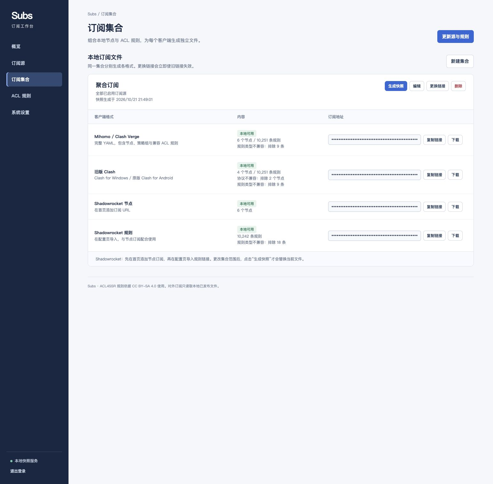

# Subs

自托管的代理订阅聚合与本地快照服务，使用 Go 开发。将多个上游订阅与 ACL4SSR Online Full 规则组合，生成适用于 Mihomo / Clash Verge、旧版 Clash 和 Shadowrocket 的订阅文件。

[GitHub](https://github.com/Yshanchui/subs) · [Docker Hub](https://hub.docker.com/r/yshanchui/subs) · [MIT License](LICENSE)

[功能特性](#功能特性) · [快速开始](#快速开始) · [客户端支持](#客户端支持) · [开发](#开发) · [贡献](#贡献) · [许可证](#许可证)

## 功能特性

- 支持手动、定时更新上游，按集合聚合全部启用源或指定源。
- 节点、策略组与规则在服务端生成快照；客户端下载只读取本地文件，不依赖上游实时可用。
- 上游更新失败保留旧缓存；发布文件写入成功后切换版本，重启后仍可下载。
- 支持 YAML、URI 和 Base64 URI 输入，按客户端协议能力过滤节点与规则，并显示排除数量。
- 中文管理后台随二进制内嵌，无需 Node.js、Sub-Store 或 SubConverter。
- 管理员密码使用 bcrypt 哈希；会话使用 HttpOnly / SameSite Cookie，写操作校验 CSRF，登录失败有限速。
- 提供 amd64 / arm64 Docker 镜像，以及包含 Cloudflare DNS-01 的 HTTPS 部署配置。

## 界面预览



## 快速开始

推荐使用 Docker Compose 部署。下方完整 HTTPS 方案需要 Docker、Docker Compose、一个由 Cloudflare 管理 DNS 的域名，以及该域名的 API Token。也可以[仅运行 Subs 容器](#docker-单容器部署)，接入已有反向代理。

项目根目录包含 `compose.yaml`、`Caddyfile`、`Dockerfile.caddy` 和 `.env.example`。默认部署 Subs 与 Caddy，后台和订阅统一使用 `https://你的域名:8443`，证书通过 Cloudflare DNS-01 自动签发和续期。

Subs 使用 [`yshanchui/subs:20261026`](https://hub.docker.com/r/yshanchui/subs)，支持 `linux/amd64` 和 `linux/arm64`；另提供 `latest`。Caddy 通过 Docker Compose 按宿主机架构构建。

### 1. 准备配置

```sh
git clone https://github.com/Yshanchui/subs.git
cd subs
# 仅首次部署时复制；已有 .env 请保留。
cp .env.example .env
```

编辑 `.env`：

| 变量 | 配置 |
| --- | --- |
| `SUBS_DOMAIN` | 域名，例如 `subs.example.com`，不带协议、端口或路径 |
| `SUBS_ADMIN_USER` | 初始管理员账号，默认 `admin` |
| `SUBS_ADMIN_PASSWORD` | 必填，12–72 字节；首次初始化后以数据目录中的账号为准 |
| `CLOUDFLARE_API_TOKEN` | 必填，目标 Zone 的 `Zone:Read` 和 `DNS:Edit` 权限 |
| `SUBS_ALLOW_PRIVATE_UPSTREAM` | 默认 `false`；可信内网订阅或 Fake-IP DNS 环境才设为 `true` |

密码或 Token 包含 `$`、`#` 等字符时，用单引号包裹完整值。`.env` 必须保密，不进入 Git 或镜像；不要用空模板覆盖已有配置。

Cloudflare API Token 的资源范围应限定为目标 Zone，只填 Token 字符串，不带 `Bearer`。不要使用 Global API Key，也不要把 Token 写进 Caddyfile、Dockerfile 或构建参数。

域名 A 记录指向部署主机的公网 IPv4，并开放 **TCP 8443**；主机位于路由器后时，将公网 8443 转发到主机 8443。如配置 AAAA，IPv6 访问路径也必须可达。DNS-01 签发不要求任何入站端口，但部署环境需要能访问 Cloudflare API、ACME 服务和公共 DNS。

### 2. 启动

在项目根目录执行：

```sh
docker compose config --quiet
docker compose pull subs
docker compose build caddy
docker compose run --rm --no-deps caddy caddy validate --config /etc/caddy/Caddyfile --adapter caddyfile
docker compose up -d
docker compose ps
```

使用 `--quiet` 校验 Compose，避免输出解析后的密码和 Token。首次构建 Caddy 需要下载基础镜像与 Go 依赖。官方普通 Caddy 镜像不含 Cloudflare DNS 模块；本项目使用 Caddy 2.11.7 和 `caddy-dns/cloudflare@v0.2.4`，构建时检查 `dns.providers.cloudflare` 模块。

Compose 只发布 `8443:443`，Subs 的 8787 仅在容器网络内使用。Caddy 显式关闭 HTTP-01、TLS-ALPN-01 和 HTTP 重定向，使用 DNS-01 管理证书。`SUBS_PUBLIC_URL` 自动设置为 `https://${SUBS_DOMAIN}:8443`，生成的订阅地址也包含 8443。

### 3. 添加订阅

1. 打开 `https://你的域名:8443/`，使用初始化的账号密码登录。
2. 在「订阅源」添加上游 URL，并更新一次；在「ACL 规则」确认规则已下载。
3. 在「订阅集合」生成快照，复制目标客户端的链接。
4. Clash Verge 使用 Mihomo 链接；Shadowrocket 分别导入节点订阅和规则配置链接。

后台 `/api/*` 需要登录；`/s/<token>/<格式>` 通过随机链接授权，持有链接即可下载。不要为整个站点统一加反代 Basic Auth，否则客户端可能无法更新订阅。更换集合链接会立即撤销旧地址。

### 更新

保留当前 `.env`、Caddyfile 和持久化卷，修改 `compose.yaml` 中的 Subs 镜像标签后执行：

```sh
docker compose pull subs
docker compose up -d --no-deps subs
```

生成器更新后，在「订阅集合」重新生成快照，再让客户端更新订阅。已有快照不会因镜像更新自动改写，无需重新拉取上游。

### Docker 单容器部署

如果只需要 Subs，或已有 HTTPS 反向代理，可以直接运行 Docker 镜像。创建私有文件 `.env.docker`，填写 12–72 字节的管理员密码：

```dotenv
SUBS_ADMIN_USER=admin
SUBS_ADMIN_PASSWORD=
```

```sh
docker run -d \
  --name subs \
  --restart unless-stopped \
  --env-file .env.docker \
  --publish 127.0.0.1:8787:8787 \
  --mount type=volume,source=subs-data,target=/data \
  yshanchui/subs:20261026
```

本机访问 `http://127.0.0.1:8787`。通过 HTTPS 反向代理对外提供服务时，在 `.env.docker` 中设置 `SUBS_PUBLIC_URL=https://你的域名:端口`，再重新创建容器。单容器部署无需 Cloudflare Token；`.env.docker` 已被 Git 和镜像构建上下文排除。

## 数据持久化与备份

| Docker 卷 | 用途 |
| --- | --- |
| `subs-data` | 管理员账号、源地址、节点缓存、ACL 规则和本地快照 |
| `subs-caddy-data` | ACME 账号、证书及续期状态 |
| `subs-caddy-config` | Caddy 持久化配置 |

Subs 容器以 UID/GID 10001 运行，使用 `/data`。需要绑定宿主机目录时，将 `subs-data:/data` 改为 `./data:/data`，并确保 UID 10001 可读写。更新、重建或停止容器时保留卷，**不要执行 `docker compose down -v`**。

备份时先停止 Subs，再备份完整 `subs-data`；Caddy 证书卷也应备份。数据中包含订阅凭据，备份同样需要保密。迁移已有实例时，先停止原进程，再复制完整数据目录并修正所有者；不要只复制单个快照，也不要重新创建空卷覆盖原数据。三个卷名固定，迁移 Compose 项目目录时也应保留这些卷和自定义环境变量。

本机运行时的数据结构：

```text
data/
├── state.json                      # 账号哈希、源地址、节点缓存、ACL、发布版本指针
└── snapshots/<集合ID>/<版本>/       # 已发布的订阅文件
```

数据目录权限为 0700，文件为 0600；一个数据目录只允许一个进程写入。文件使用临时写入、fsync 和 rename，每个集合保留当前及上一版本。删除源不会撤销已有快照；删除集合会撤销其所有下载链接。修改源启用状态或集合范围后，需要重新生成快照。

管理员密码只在首次初始化时读取环境变量，后续请在后台修改。忘记密码时，先停止服务，再使用同一数据卷和 Subs 镜像执行 `-reset-password`；本机源码运行方式见下文。不要删除数据目录重置密码。

## 客户端支持

| 客户端 | 输出格式 | 行为 |
| --- | --- | --- |
| Mihomo / Clash Verge | `mihomo` 完整 YAML | 节点、ACL 策略组、规则及 DNS、IPv6、嗅探设置；也适用于使用 Mihomo 的安卓客户端 |
| 旧 Clash for Windows / 原版 Clash for Android | `clash` 完整 YAML | 只保留旧核心支持的协议和字段，使用明确节点列表 |
| Shadowrocket 节点 | `shadowrocket` Base64 URI | 在首页添加订阅 URL |
| Shadowrocket ACL 规则 | `shadowrocket-rules` 配置 | 在配置页导入，使用 `PROXY` / `DIRECT` / `REJECT`，与节点订阅配合 |

**格式转换不会改变代理协议。** 旧 Clash 不支持 VLESS、Hysteria2 等协议，导出时会排除；管理页显示各格式的节点、规则和排除数量。没有兼容节点时显示不可用，已有快照则继续提供旧版并显示警告。

Mihomo 的默认网络配置：

- 顶层和 DNS 的 IPv6 均关闭，保留 mixed 端口 7890；TUN 由客户端管理。
- DNS 监听 `127.0.0.1:7874`，使用 `198.18.0.1/16` Fake-IP，启用 `respect-rules` 和 hosts。
- 普通域名与节点域名使用阿里、腾讯 DoH，`223.5.5.5` / `119.29.29.29` 用于解析 DoH 服务器本身。
- 局域网、连通性检测、时间同步和 STUN 域名设有 Fake-IP 排除项。
- HTTP（80、443、8080）与 TLS（443、8443）嗅探开启，不启用纯 IP 嗅探。

这些设置写在 YAML 顶层，不改变 ACL 分流规则及顺序，也不混入源订阅自带的 DNS、端口或策略。旧 Clash 和 Shadowrocket 沿用各自的输出行为。客户端全局设置或扩展配置可能覆盖订阅值，应检查实际运行配置；开启 DNS、嗅探不会自动接管所有应用流量。

## 输入格式与更新行为

支持 Clash/Mihomo YAML 的 `proxies` 数组、纯文本 URI 和 Base64 URI 列表。URI 覆盖 SS、SSR、VMess、VLESS、Trojan、Hysteria2、TUIC、SOCKS5 和 HTTP(S)；YAML 还支持 Hysteria、Snell、WireGuard、SSH、AnyTLS 等 Mihomo 节点映射，并保留原始字段。外部 `proxy-providers` 不递归拉取，输入必须包含实际节点。

VMess/VLESS 支持常见 TCP、WebSocket、HTTP/2、HTTP、gRPC、TLS / Reality 参数。无法转换的目标协议会明确排除；未知协议、无效节点或未支持的 URI 传输层会使本次源更新失败，保留旧缓存。导入会去掉流量、到期信息占位项，聚合按连接参数去重，节点名带源名称前缀。

默认每 6 小时检查启用源，可设为 0（仅手动）或至少 5 分钟；规则默认每 24 小时更新，可设为 1–720 小时。手动更新源会自动重新生成集合，单独更新规则使用已有节点缓存。源必须至少成功拉取一次；快照只能保留配置，不能让已失效的节点凭据恢复可用。

ACL4SSR Full 包含部分客户端不支持的规则类型。Mihomo/旧 Clash 排除 `USER-AGENT`、`URL-REGEX`；Shadowrocket 排除不兼容的进程匹配等条目及含逗号的正则，数量在后台显示。无匹配节点的区域组使用 `REJECT`；GeoIP 依赖客户端自己的数据库，测速会请求模板中的探测地址。

## 上游访问与安全

上游仅允许 HTTP(S)，超时 30 秒、最多 5 次重定向、正文上限 10 MiB；默认拒绝本地、私有和保留地址，并在连接时校验 DNS 结果。使用可信内网订阅或代理 Fake-IP DNS（例如 `198.18.*`）时，在 `.env` 设置 `SUBS_ALLOW_PRIVATE_UPSTREAM=true`，再重新创建 Subs 容器：

```sh
docker compose up -d --no-deps --force-recreate subs
```

此开关扩大允许访问的目标范围，仅用于可信环境；HTTPS 证书校验仍保留。Subs 不自动使用系统 HTTP 代理。

`.gitignore` 排除 `.env`、本地数据、二进制与发布包；两个 Dockerfile 分别使用白名单构建上下文，凭据只在运行时注入。订阅链接本身就是凭据。提交 Issue、Pull Request 或诊断日志前，请删除真实订阅地址、节点密码、管理员密码、Token 和数据文件。

已有反向代理时，可保留 Subs 服务和数据卷，将它接入代理所在网络并反代 `subs:8787`。若保留当前 Caddy 方案，需合并站点块、保留 Cloudflare 模块和 Token 环境变量；一个 Caddyfile 只能有一个全局块。不要删除证书卷强制重新申请证书。

## 开发

需要 Go 1.26 或更新版本，支持 Linux / macOS / BSD。默认监听 `127.0.0.1:8787`，默认数据目录为 `./data`：

```sh
SUBS_ADMIN_USER=admin SUBS_ADMIN_PASSWORD='替换为至少12字符的强密码' go run .
```

打开 `http://127.0.0.1:8787`。本机运行不会自动读取 Compose 的 `.env`。忘记密码时，先停止原进程，使用同一数据目录执行：

```sh
SUBS_ADMIN_USER=admin SUBS_ADMIN_PASSWORD='新的至少12字符密码' go run . -reset-password
```

| 服务端环境变量 | 默认值 / 用途 |
| --- | --- |
| `SUBS_LISTEN` | `127.0.0.1:8787`；容器中为 `0.0.0.0:8787` |
| `SUBS_DATA_DIR` | `./data`；容器中为 `/data` |
| `SUBS_PUBLIC_URL` | 默认取页面来源；Compose 固定为带 8443 的 HTTPS 域名 |
| `SUBS_SECURE_COOKIE` | 默认 `false`；HTTPS PUBLIC_URL 自动启用，Compose 显式启用 |

```sh
make test                 # go test -race ./... 和 go vet ./...
node --check web/app.js
make build                # bin/subs，包含内嵌静态资源
```

安装 Mihomo 后，可执行 `SUBS_TEST_MIHOMO_BINARY=/绝对路径/mihomo go test -run TestMihomoCoreAcceptsGeneratedConfig -v .`，用模拟节点检查生成配置是否被核心接受。该检查不读取正式订阅或修改客户端配置。

需要自行构建 Subs 镜像时，在根目录执行 `docker build -t subs:local .`；默认 Compose 使用 Docker Hub 镜像。测试涵盖格式解析、ACL 兼容、快照保留、重启持久化、数据锁、失败回滚、鉴权、CSRF、限速和私网请求边界。项目不自动迁移 Sub-Store 数据或提供内网穿透。

主要目录：

```text
.
├── *.go                      # 服务端、订阅解析、规则生成和测试
├── web/                      # 内嵌管理后台
├── compose.yaml              # Subs 与 Caddy 部署
├── Caddyfile                 # HTTPS 与 Cloudflare DNS-01
├── Dockerfile                # Subs 镜像
├── Dockerfile.caddy           # 带 Cloudflare 模块的 Caddy 镜像
├── .env.example              # 环境变量模板
├── docs/                     # 文档资源
├── licenses/                 # 第三方许可证
├── THIRD_PARTY_NOTICES.md
└── LICENSE
```

## 贡献

欢迎通过 [Issues](https://github.com/Yshanchui/subs/issues) 反馈问题或提出建议，通过 [Pull Requests](https://github.com/Yshanchui/subs/pulls) 提交改进。

- 报告问题时提供版本、部署方式、复现步骤和脱敏日志；协议解析问题请使用虚构节点参数构造最小示例。
- 提交代码前运行 `make test`；修改前端脚本时运行 `node --check web/app.js`。
- 修改格式兼容或规则生成逻辑时，补充对应的最小测试；同步更新受影响的配置说明。
- 不要提交 `.env`、`data/`、真实订阅文件、密钥或本地构建产物。

## 许可证

项目自有源码采用 [MIT License](LICENSE)。第三方依赖与规则数据保留各自的许可证：运行时下载的 ACL4SSR 规则数据及其衍生规则输出遵循 **CC BY-SA 4.0**，不因本项目使用 MIT 而改变。完整依赖声明见 [THIRD_PARTY_NOTICES.md](THIRD_PARTY_NOTICES.md) 和 `licenses/`。

## 致谢与参考

- 规则模板：[ACL4SSR Online Full](https://github.com/ACL4SSR/ACL4SSR/blob/master/Clash/config/ACL4SSR_Online_Full.ini)，规则数据遵循 [CC BY-SA 4.0](https://github.com/ACL4SSR/ACL4SSR)；生成文件保留来源和许可注释。
- Mihomo 规则参考：[MetaCubeX 文档](https://wiki.metacubex.one/config/rules/)。
- Caddy：[Cloudflare DNS 模块与权限](https://github.com/caddy-dns/cloudflare)、[添加模块](https://hub.docker.com/_/caddy)、[自动 HTTPS 选项](https://caddyserver.com/docs/caddyfile/options#auto-https)。
- Docker：[Dockerfile 专用忽略文件](https://docs.docker.com/build/concepts/context/#filename-and-location)。
- Go 依赖：`golang.org/x/crypto/bcrypt`、`go.yaml.in/yaml/v3`，原始许可见 [THIRD_PARTY_NOTICES.md](THIRD_PARTY_NOTICES.md) 和 `licenses/`。未链接 Mihomo 或 SubConverter 源码。
- Shadowrocket 能力以客户端版本为准，见 [维护者页面](https://apps.apple.com/app/shadowrocket/id932747118)。
